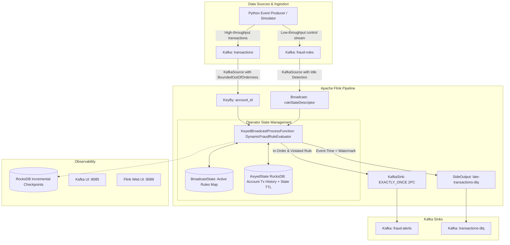

# Real-Time Transaction Anomaly & Dynamic Rule Engine

[](https://flink.apache.org/)
[](https://kafka.apache.org/)
[](https://openjdk.org/)
[](https://www.docker.com/)
[](https://rocksdb.org/)

A production-grade, distributed real-time stream processing platform built with **Apache Flink**, **Apache Kafka (KRaft mode)**, and **RocksDB**. The engine evaluates high-throughput financial transactions against dynamic fraud rules that can be added, updated, or deactivated at runtime without restarting or redeploying the Flink streaming job.

---

## 1. Architectural Overview



---

## 2. Core Distributed Systems Mechanics

### A. Dynamic Broadcast State Pattern
* **Control Plane (`processBroadcastElement`):**
  * Incoming rules from `fraud-rules` topic are broadcasted across all operator parallel instances using Flink's `BroadcastStream`.
  * Active rules are maintained in a `MapStateDescriptor<String, Rule>`. Setting `is_active: false` removes the rule in-place.
* **Data Plane (`processElement`):**
  * Ingested transactions are partitioned by `account_id` via `.keyBy(Transaction::getAccountId)`.
  * Each subtask accesses rules deterministically via `ReadOnlyBroadcastState` with zero thread contention or lock acquisition.

### B. Event-Time, Watermarks & Late-Data Isolation (DLQ)
* **Watermark Strategy:**
  * Timestamps extracted from transaction `event_time`.
  * `WatermarkStrategy.forBoundedOutOfOrderness(Duration.ofSeconds(10))` allows up to 10 seconds of network jitter or out-of-order delivery.
  * Idle partition detection via `.withIdleness(Duration.ofSeconds(1))` prevents multi-partition pipeline stalls.
* **Dead Letter Queue (DLQ) Routing:**
  * If a transaction arrives with `ctx.timestamp() < ctx.currentWatermark()`, it is flagged as unrecoverably late.
  * Late records bypass rule evaluation (avoiding state corruption) and are routed via `OutputTag<Transaction>("late-transactions-dlq")` to the `transactions-dlq` topic.

### C. State Backend & Checkpointing (Fault Tolerance)
* **Embedded RocksDB State Backend:**
  * Out-of-core keyed state stored in `EmbeddedRocksDBStateBackend` with native C++ memory management and SST incremental checkpointing.
* **Checkpoints:**
  * Triggered every 10 seconds (`10,000 ms`) with `CheckpointingMode.EXACTLY_ONCE`.
  * Minimum pause of 5 seconds between checkpoints prevents checkpoint saturation.
  * Retained on cancellation (`ExternalizedCheckpointCleanup.RETAIN_ON_CANCELLATION`).
* **State Lifecycle & Memory Guard (TTL):**
  * Per-account history configured with `StateTtlConfig` (1-hour TTL with `OnCreateAndWrite` and `NeverReturnExpired`) to prevent memory leaks from dormant accounts.

### D. End-to-End Exactly-Once Semantics (EOS)
* **Two-Phase Commit (2PC):**
  * Sinks use `KafkaSink` configured with `DeliveryGuarantee.EXACTLY_ONCE`.
  * Transactional ID prefixes (`fraud-alert-sink-`, `fraud-dlq-sink-`) coupled with a 15-minute Kafka transaction timeout ensure zero duplicate alerts or DLQ entries during failures.

---

## 3. Project Structure

```text
.
├── docker-compose.yml              # Kafka KRaft, Kafka UI, Flink JobManager & TaskManager
├── flink-job/
│   ├── pom.xml                     # Flink 1.19.0, Kafka Connector 3.3.0, RocksDB, Shade Plugin
│   └── src/main/java/com/anomaly/engine/
│       ├── AnomalyEngineApp.java   # Top-level streaming DAG wiring
│       ├── config/
│       │   └── JobConfig.java      # Centralized topic, watermark & checkpoint constants
│       ├── functions/
│       │   └── DynamicFraudRuleEvaluator.java  # KeyedBroadcastProcessFunction implementation
│       ├── model/
│       │   ├── Alert.java          # Fraud alert POJO
│       │   ├── Rule.java           # Dynamic rule POJO
│       │   ├── RuleType.java       # Enum: SINGLE_TRANSACTION_THRESHOLD, SLIDING_WINDOW, BURST
│       │   ├── Transaction.java    # Financial transaction POJO
│       │   └── TransactionSummary.java # Compact state representation
│       └── serialization/
│           ├── AlertSerializationSchema.java
│           ├── JsonDeserializationSchema.java
│           └── TransactionSerializationSchema.java
├── producer/
│   ├── requirements.txt            # kafka-python, requests
│   └── producer.py                 # Multi-mode mock stream generator & demo runner
├── verify_pipeline.sh              # Automated end-to-end verification test suite
└── README.md
```

---

## 4. Port Allocations & Services

| Service | Internal Port | Host Port | Purpose |
| :--- | :--- | :--- | :--- |
| **Kafka Broker** | `9092` | `29092` | KRaft Kafka Broker (Producer Host Access) |
| **Kafka UI** | `8080` | `8085` | Topic, consumer group, and message inspector |
| **Flink JobManager** | `8081` | `8088` | Flink Web Dashboard & REST API |

---

## 5. Quickstart & Deployment Runbook

### Step 1: Start Infrastructure
```bash
docker compose up -d
```
Verify all containers (`fraud-engine-kafka`, `fraud-engine-jobmanager`, `fraud-engine-taskmanager`, `fraud-engine-kafka-ui`) are healthy.

### Step 2: Build the Flink Fat JAR
```bash
cd flink-job
mvn clean package -DskipTests
cd ..
```
The shaded executable JAR will be generated at `flink-job/target/realtime-transaction-anomaly-engine-1.0.0.jar`.

### Step 3: Deploy Job to Flink Cluster
```bash
docker cp flink-job/target/realtime-transaction-anomaly-engine-1.0.0.jar fraud-engine-jobmanager:/opt/flink/job.jar

docker exec -t fraud-engine-jobmanager flink run -d \
  -c com.anomaly.engine.AnomalyEngineApp \
  /opt/flink/job.jar \
  --bootstrap.servers kafka:9092
```
Access the Flink Web UI at [http://localhost:8088](http://localhost:8088) to verify that the job is in the `RUNNING` state.

---

## 6. End-to-End Testing & Verification

### Option A: Run Automated Verification Suite
Run the full health check and automated test script:
```bash
./verify_pipeline.sh
```

### Option B: Interactive Simulation via Producer
Create and activate the Python environment:
```bash
python3 -m venv producer/venv
./producer/venv/bin/pip install -r producer/requirements.txt
```

#### 1. Run Automated Demo
Executes baseline rule emission, normal traffic, anomaly injection, burst detection, late-data DLQ routing, and dynamic zero-downtime rule updates:
```bash
./producer/venv/bin/python producer/producer.py --mode demo
```

#### 2. Continuous Transaction Streaming
```bash
./producer/venv/bin/python producer/producer.py --mode stream --rate 10
```

#### 3. Inject Dynamic Rule at Runtime (Zero Downtime)
Update single transaction threshold to $1,500 without restarting Flink:
```bash
./producer/venv/bin/python producer/producer.py --mode rule \
  --rule-id RULE_CUSTOM_1 \
  --rule-type SINGLE_TRANSACTION_THRESHOLD \
  --threshold 1500.0 \
  --active true
```

#### 4. Inject Late Records for DLQ Validation
Send records timestamped 60 seconds in the past:
```bash
./producer/venv/bin/python producer/producer.py --mode late --skew 60 --count 3
```

#### 5. Real-Time Alert & DLQ Terminal Monitor
```bash
./producer/venv/bin/python producer/producer.py --mode monitor
```

---

## 7. Inspecting Kafka Topics

Inspect messages directly via Kafka CLI:

```bash
# Read committed alerts
docker exec -it fraud-engine-kafka kafka-console-consumer \
  --bootstrap-server kafka:9092 \
  --topic fraud-alerts \
  --from-beginning \
  --isolation-level read_committed

# Read DLQ records
docker exec -it fraud-engine-kafka kafka-console-consumer \
  --bootstrap-server kafka:9092 \
  --topic transactions-dlq \
  --from-beginning \
  --isolation-level read_committed
```

Or open **Kafka UI** in your browser at [http://localhost:8085](http://localhost:8085).
